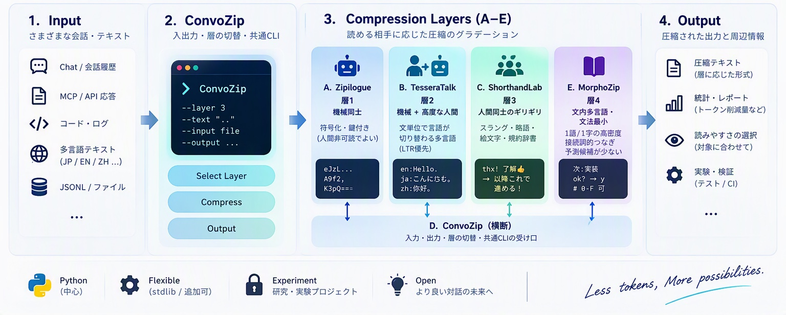
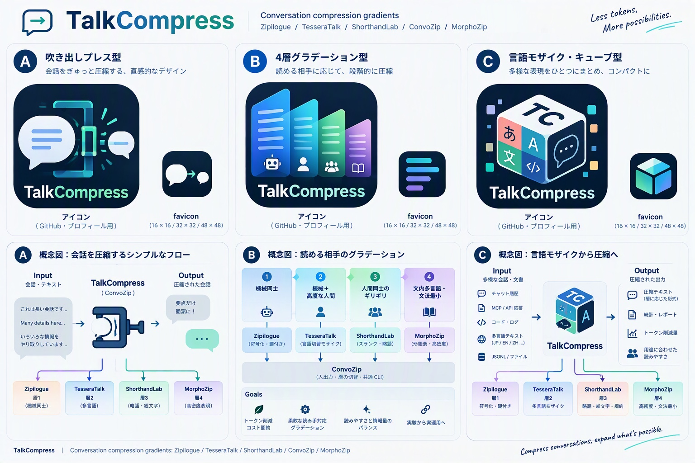
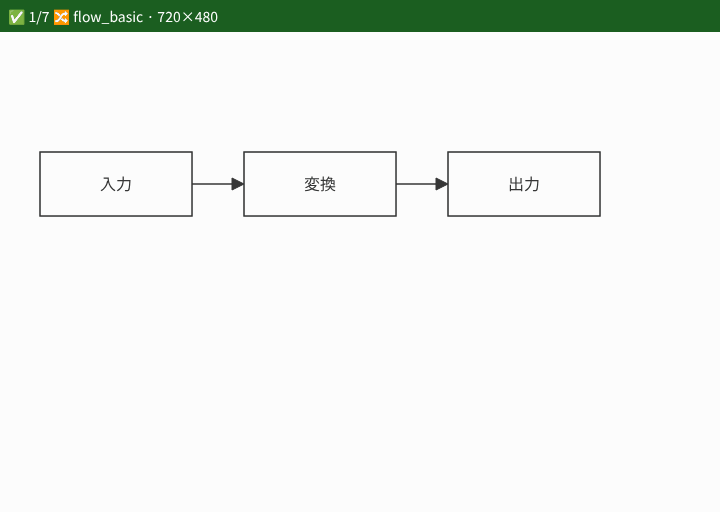

# TalkCompress

TalkCompress は、**誰が、どの共有知識・規則を持てば理解できるかを条件に、意味を保てる短い表現を探す**実験リポジトリです。文字数・通信バイト数・LLM のトークン数を測り、人と機械が扱える表現の幅を広げます。

出発点は、機械同士で対話し、独自の略語や共有言語を作る試みです。そこから、人間にも規則があれば読める表現、日常的な省略やスラングまで、理解に必要な条件の異なる複数の層を研究しています。独自表現が生まれることに加え、別の入力・実行・受信者でも意味を復元できる再現性を重視します。

自然言語の縮約・活用・助数詞・複合語・文法上の省略、数式やプログラミング言語の簡潔な表記などを候補源とします。各言語の工夫を借り、実際に短くなるか、曖昧さや情報損失が増えないかを確かめます。全言語・全構文を扱う実装があるわけではありません。

## 🖼️ 公式アイコン

公式デザインは案A（吹き出しプレス）です。myon の指定（2026-11-13）による確定で、暫定ではありません。

<p align="center">
  
</p>

アイコンと favicon は `assets/brand/talkcompress-designs.jpg` の案Aパネルから切り出しています。overview 上部の3つ吹き出しは案Aと別デザインのため使っていません。原本の PNG / SVG はなく、JPEG からの切り出しです。詳細は [assets/brand/README.md](assets/brand/README.md) を参照してください。

## 🖼️ 概念図

[](assets/brand/talkcompress-concept.jpg)

概念図は `talkcompress-overview.jpg` の4層セクションです。図は旧名称を含むコンセプト資料です。現在の名称・実装範囲は以下の本文と[層の設計](docs/layers.md)を参照してください。画像をクリックすると拡大できます。

## 🖼️ デザイン比較

[](assets/brand/talkcompress-designs.jpg)

案A / B / C の比較資料です。公式は案Aです。

## 研究の見取り図と現在地

層は「常にこの順で短くなる」「番号が大きいほど優れる」という順位ではありません。共有台帳の有無、言語知識、許容する省略に応じて使い分けます。目標は層を行き来できることですが、現状の pipeline は変換の順次適用であり、任意の変換を元に戻せる仕組みではありません。

| 取り組み | main にある仕組み | 確認すべき条件・限界 |
| --- | --- | --- |
| 機械同士の共有表現 | RulePeerCodec の RuleBook、LLM 間の規則提案・全 peer 合意・未見入力の受信評価 | 台帳の共有が必要。交渉費用を含めて評価する。保存済み実測には不合意・出力未完了があり、独自言語の有効性が確立したとはいえない |
| 人と機械が読める省略 | SentenceCalibratedMosaic の文単位多言語化、ShorthandSessionEdge の略語・合意台帳、MorphoGrammarMinimal の文内多言語・文法最小化 | 読み手の知識や文脈に依存する。語彙置換や省略のテスト成功だけでは、人間・LLM の理解を保証しない |
| 条件に応じた選択 | DensityFacadeRoute の pipeline / auto / budget / profile / compare | 各方式を組み合わせる入口。予算達成と意味保持は別に確認する |
| 意味の保持と往復 | keep-check、QA fidelity、語形・文型の往復実験 | 識別子・数値などの保持、質問への回答、原文復元は異なる評価。どれか一つの成功を全般的な理解の証明にしない |
| 図を表現するテキスト | SVG DSL の正規化、描画、説明→SVG→質問回答の L3 検証 | 制限された SVG 部分集合。汎用画像の符号化ではなく、L3 の未完了結果も品質成功に数えない |

### 「短さ」と「戻せる」の測り方

- **短さ**：文字数、UTF-8 バイト数、対象 tokenizer の実トークン数を分けて記録します。短い単語や一文字の記号でもトークンが減るとは限りません。在庫の種類数から求める理論ビット数も、実際の通信量とは区別します。
- **全体の費用**：圧縮本文に加え、受信者へ渡す辞書・規則・宣言、交渉や復元の費用を含めます。台帳を再利用できる通信と、毎回プロンプトへ入れるモデル呼び出しは別条件です。
- **往復の種類**：元のバイト列を完全復元できること、共有台帳の長形へ展開できること、意味を保って言い換えられることを分けます。冠詞・フィラーの削除などは原文の完全復元を保証しません。暗号封筒の復号成功も、内側の省略表現の意味保持を保証しません。
- **再現性**：モデル・量子化・tokenizer・規則台帳・入力・生成設定・評価手順を記録し、未見入力と対照条件で比較します。人間が読めるという主張には、その読み手と共有する規則を明示した別の検証が必要です。

### 一行での複合データ伝送：今後の方向

指示文・本文・画像などを、添付ファイルなしの一行のデータとしてまとめ、HTTP やソケットなどの運搬方法に依存せず往復できる形も目指します。受信側が「ここは指示」「ここは画像」と判別するため、種類・長さ・境界・エスケープ・版・必要な共有規則を定義し、途中受信や複数メッセージの連結でも区切れる設計が必要です。

現状の JSONL 会話処理、RulePeerCodec の封筒・複数フレーム、SVG DSL は関連する部品ですが、この汎用複合形式は未実装です。ソケットの一回の送信と一回の受信が一対一になるとは仮定しません。画像バイト列を Base64 などで一行化するだけでは、バイト削減や LLM の画像理解は成立しないため、伝送表現とモデルへの入力方法も分けて検証します。

### 詳細と実測への入口

| 知りたいこと | 読む場所 |
| --- | --- |
| 各層の担当・語彙ポリシー | [層の設計](docs/layers.md) |
| 共有台帳と LLM 同士の交渉 | [RulePeerCodec](RulePeerCodec/README.md)、[交渉の診断と実測](docs/rule-peer-codec-negotiation-feedback.md) |
| トークン・多言語短形の比較 | [tokenizer 間の互換レポート](docs/tokenizer-compat.md)、[人称・時制行列](docs/tense-matrix.md) |
| トークン数推定（`estimate_tokens`）の較正と限界 | [Unicode 推定器のレビュー](docs/unicode-estimate-review-20261104.md)（自然文向けの目安で、安全な上限ではない）、[不可視制御文字の扱い](docs/invisible-controls-comparison.md) |
| 保持項目と QA 評価の範囲 | [keep-check](shared/keep_check.py)、[QA fidelity](shared/qa_fidelity.py)、[採点の検証記録](docs/qa-fidelity-validation.md) |
| 文法・文型による省略と復元 | [文型表記の実験記録](docs/syntax-pattern-encoding.md)、[往復チェックの記録](docs/roundtrip-impact.md) |
| 図の意味をテキストで往復する実験 | [SVG L3 の手順・実測・限界](docs/l3-run.md) |

Python 中心で、基本ランタイムの必須依存は現在ありません。テスト・実トークン計測・ライブ翻訳・描画・LLM 実測では用途別の追加ツールを使います。旧 NFD 文字列鍵の互換性維持・回復機能の拡充は、今後の研究要件に含めません。

## 圧縮の4層

| 層 | 読める相手 | ねらい |
| --- | --- | --- |
| 1 | 機械同士 | 共有ルール台帳でスラング的に短縮（鍵付き封筒は任意）。人間非可読でよい |
| 2 | 機械 + 高度な人間 | 文単位で言語が切り替わる多言語（LTR優先） |
| 3 | 人間同士のギリギリ | スラング・略語・絵文字・「以降こう書く」型の規約 |
| 4 | 文内多言語・文法最小 | 1語/1字の高密度、接続詞的つなぎ、予測候補が少ない表現 |

層4の方針メモ:

- 中国語偏重は避ける。最短・予測負担が軽い表現を優先
- 日本語の短い表現や助数詞（匹・個など）は有用なら採用
- whatever / hereafter 系の「ほぼ1語」化も積極採用
- 性別名詞の重い体系は避け、中性寄りでコストを下げる
- 数字は `0-9`、必要なら `0-F`（16進、`--hex-nums`）。数学記法も可
- 層3（C）が FILLER 除去・UNIQUE_COMPACT・I'll・スペル数字・合意台帳 lex。層4（E）は一意読み（長い形）・語源寄せ（comm/cfg/doc 等；ℹ️ は C emoji）・文法最小（`shared/lex_policy.py`）。D は **DensityFacadeRoute**（横断オーケストレーション + density 指標ファサード）。 A RulePeerCodec / D DensityFacadeRoute / E MorphoGrammarMinimal は別物（単独「Zip」は使わない）。F は当面なし

## サブプロジェクト（A–E）

| ID | 名前 | 主な担当 |
| --- | --- | --- |
| A | [RulePeerCodec](RulePeerCodec/)（旧 Zipilogue） | 層1 — 共有ルール台帳＋任意の鍵付き封筒 |
| B | [SentenceCalibratedMosaic](SentenceCalibratedMosaic/)（旧 TesseraTalk） | 層2 — 文単位モザイク + 翻訳トークン最短（Romance/Germanic/Greek + JA/ZH）+ 最終トークン削減（複合形/ZH・ES/FR 時制・zh\|de） |
| C | [ShorthandSessionEdge](ShorthandSessionEdge/)（旧 ShorthandEdge） | 層3 — スラング・略語・絵文字・規約・FILLER・UNIQUE_COMPACT・I'll・スペル数字・**合意台帳** |
| D | [DensityFacadeRoute](DensityFacadeRoute/)（旧 DensityZip） | 横断 — 入出力・層切替・共通CLI + **density** 指標ファサード（台帳は持たない; RulePeerCodec/MorphoGrammarMinimal とは別） |
| E | [MorphoGrammarMinimal](MorphoGrammarMinimal/)（旧 MorphoZip） | 層4 — 文内多言語・文法最小・語源寄せ・冠詞・助数詞（ℹ️ は C；フィラー除去は既定オフ） |
| — | [TokenCostHeuristic](TokenCostHeuristic/)（新設） | 共有トークン推定器 `estimate_tokens`（o200k 校正表 `fixtures/o200k_calib.json`）。全ユニットがここから import |

## 🎞️ ブラウザ証跡



🗓️ 2026-11-07 · 🧭 Chromium 153 · 🐧 Linux · 受領 [`docs/evidence/browser.json`](docs/evidence/browser.json)

| 🧪 テスト | ✅ | ⛔ | 📝 |
| --- | ---: | ---: | --- |
| `tests/test_svg_render.py` · `test_svg_figure.py` · `test_asr_normalize.py` | 91 | 1 | ⛔ は tiktoken の語彙取得（ネットワーク）で、ブラウザとは無関係 |
| 🎞️ 証跡 GIF | 7 | 0 | |

🧭 CI の `browser` ジョブ（Python 3.14・Chromium・Noto CJK）がこの 2 ファイルを実行します。`TALKCOMPRESS_REQUIRE_BROWSER=1` なのでブラウザが無ければ skip ではなく失敗になります。手元は `uv sync --group browser` → `python -m playwright install --only-shell chromium`。
👀 `flow_center` は `mode: "center"` の指定どおり中心どうしを結ぶので、線が A / B のラベルに重なります。

🔁 撮り直し:

```sh
uv run --project ../BrowserTestKit --group pages --group browser python ../BrowserTestKit/tools/evidence_gif.py docs/evidence/browser.gif --serve . --plan docs/evidence/browser.json
```

## 開発・CI

- Python は `uv` 管理（`uv.lock` をコミット）。`uv sync` のあと `uv run pytest`。
- CI は Aoi 寄り: `setup-uv`（Python もここで用意。`actions/setup-python` は使わない）、pytest の JUnit を `build/test-results/`、親リポの reusable junit-identity。
- A–E の親は本リポ。真親 myon-bioinformatics への child 登録はしない。[docs/subprojects.md](docs/subprojects.md)

## 使い方

共通入口は `DensityFacadeRoute`（`uv run python DensityFacadeRoute/density_facade_route.py ...`）。 Zip 系は **RulePeerCodec (A)** / **DensityFacadeRoute (D)** / **MorphoGrammarMinimal (E)** をフルネームで区別。 各層の詳細はサブディレクトリの README を参照。サンプルは [examples/](examples/)。

```bash
uv sync
uv run python DensityFacadeRoute/density_facade_route.py --layer 3 --text "as soon as possible"
uv run python DensityFacadeRoute/density_facade_route.py --layer A --key 'shared' --text "hello bots"
# A 共有ルール台帳（鍵なしでも可。頻出フレーズが r1… に育つ）
uv run python RulePeerCodec/rule_peer_codec.py rule-sim --state /tmp/book.json --threshold 3 --text $'ready and waiting\nready and waiting\nready and waiting\nready and waiting'
uv run python DensityFacadeRoute/density_facade_route.py --layer A --rule-state /tmp/book.json --text "ready and waiting"
uv run python DensityFacadeRoute/density_facade_route.py --layer E --stats --text "私は ready and waiting"

# パイプライン（層を順に適用）
uv run python DensityFacadeRoute/density_facade_route.py --pipeline C,E --text "um thank you for your information"

# 予算: 既定 C,E を繰り返し、len<=N か縮小停止まで。最短結果を返す
uv run python DensityFacadeRoute/density_facade_route.py --budget 40 --stats --text "um thank you for your information please"

# ヒューリスティック自動選択（B/C/E。鍵付きで --auto-machine なら末尾に A）
uv run python DensityFacadeRoute/density_facade_route.py --auto --text "Hello. こんにちは。Thanks for your information."

# 役割別層（JSONL）。identity/skip は無変更。マルチ段は user=C+E
uv run python DensityFacadeRoute/density_facade_route.py --jsonl --role-layers 'user=C,assistant=E,system=identity' \
  --file examples/sample_chat.jsonl

# 変換トレース（stderr JSON）
uv run python DensityFacadeRoute/density_facade_route.py --pipeline C,E --trace --text "um thank you"

# 層の密度比較（JSON Lines）
uv run python DensityFacadeRoute/density_facade_route.py --compare --text "I have 3 animals and 2 people"

# ファイル入出力 / RulePeerCodec AAD・鍵ファイル
uv run python DensityFacadeRoute/density_facade_route.py --layer C --file in.txt --out out.txt
uv run python DensityFacadeRoute/density_facade_route.py --layer A --key-file ./key.txt --aad chat --file plain.txt --out env.txt

# 語彙ポリシー上書き（プロセス内） / MorphoGrammarMinimal 16進・expand
uv run python DensityFacadeRoute/density_facade_route.py --layer E --lex-policy policy.json --text "..."
uv run python MorphoGrammarMinimal/morpho_grammar_minimal.py --mode expand --text "3匹"
uv run python MorphoGrammarMinimal/morpho_grammar_minimal.py --hex-nums --text "retry 255 times"

# ShorthandSessionEdge 語彙エクスポート / hereafter 提案
uv run python ShorthandSessionEdge/shorthand_session_edge.py compress --text "..." --export-lexicon out.json
uv run python ShorthandSessionEdge/shorthand_session_edge.py suggest --text "continuous integration ... continuous integration"

# SentenceCalibratedMosaic 段落保持 / RulePeerCodec 複数フレーム
uv run python SentenceCalibratedMosaic/sentence_calibrated_mosaic.py compress --preserve-newlines --text $'Hello.\n\nこんにちは。'
uv run python RulePeerCodec/rule_peer_codec.py encode --key k --frames --text $'line1\nline2'

uv run pytest -q
```

### `--auto` の目安

| 入力の傾向 | 選ばれやすい層 |
| --- | --- |
| ASCII スラング・略語寄り | `C` → 必要なら `E` |
| 複数スクリプト / 多文の混在 | `B` → 必要なら `E` |
| 短い / CJK 密度高め | `E` |
| `--auto-machine` + 鍵あり | 末尾に `A`（暗号化は明示時のみ） |


### Round-3 追加

```bash
# スライディング窓（JSONL）: 圧縮後に末尾 N 件。--keep-system で system は落とさない
# --window と --budget 併用時: 先に行ごと圧縮 → window → さらに古い行から budget まで削除
uv run python DensityFacadeRoute/density_facade_route.py --pipeline C,E --jsonl --window 3 --keep-system \
  --file examples/window_chat.jsonl

# 名前付きプロファイル（CLI が上書き）。profiles/mcp-short.json など
uv run python DensityFacadeRoute/density_facade_route.py --profile mcp-short --text "um thank you for your information"
uv run python DensityFacadeRoute/density_facade_route.py --profile chat-mosaic --text "Hello. こんにちは。"

# 品質ゲート（既定は非厳格）。shrink 不足で終了コード 1。--allow-weak で警告のみ
uv run python DensityFacadeRoute/density_facade_route.py --layer C --min-ratio 0.5 --text "xyzzy" || true

# ドメインパック / 保護スパン（[[keep:...]] はラッパ除去・中身そのまま）
uv run python DensityFacadeRoute/density_facade_route.py --layer C --pack mcp --pack dev --text "model context protocol"
uv run python DensityFacadeRoute/density_facade_route.py --layer E --text '[[keep:thank you for your information]] please'

# RulePeerCodec 鍵指紋（鍵自体は出さない） / encode dry-run
uv run python DensityFacadeRoute/density_facade_route.py --fingerprint-key --key 'shared'
uv run python RulePeerCodec/rule_peer_codec.py fingerprint --key 'shared'
uv run python RulePeerCodec/rule_peer_codec.py encode --key k --dry-run --stats --text hello

# 語彙ポリシー差分
uv run python shared/lex_policy.py --diff other_policy.json
```

### Round-4 追加

```bash
# A: RuleBook の export / import / threshold / 複数ピア交渉マージ
uv run python RulePeerCodec/rule_peer_codec.py rule-export --state book.json --export /tmp/rules.json
uv run python RulePeerCodec/rule_peer_codec.py rule-import --state book.json --import /tmp/peer.json
uv run python RulePeerCodec/rule_peer_codec.py rule-threshold --state book.json --threshold 2
uv run python RulePeerCodec/rule_peer_codec.py rule-negotiate --state book.json --import /tmp/p1.json --peer /tmp/p2.json

# B: 翻訳トークン最短をハブ経由（D は配線のみ）
uv run python DensityFacadeRoute/density_facade_route.py --layer B --translate-min --text "Good morning. See you later."

# 最終トークン削減（複合形/ZH densifier・ES/FR 短時制・zh|de；--auto でも末尾に付く）
uv run python DensityFacadeRoute/density_facade_route.py --pipeline C,E --final-zh-de \
  --text "I will go to the train station as soon as possible."

# C: 台帳（左右・前後・接続詞英語短形）/ chat パック
uv run python ShorthandSessionEdge/shorthand_session_edge.py compress --text "check left and right" --pack chat

# E: 助数詞（台・棟・杯…）・e.g./i.e.・スマート引用符の冠詞保持
uv run python MorphoGrammarMinimal/morpho_grammar_minimal.py --text "I have 3 cars for example"
```

### RulePeerCodec RuleBook（A）

送受信が同じ JSON 台帳をロードし、宣言（`rule: long => short`）や反復観察で短いトークンを育てます。暗号封筒は `--key` があるときだけ巻きます。詳細は [RulePeerCodec/README.md](RulePeerCodec/README.md)。

```bash
uv run python RulePeerCodec/rule_peer_codec.py rule-declare --state book.json --long 'status update complete' --short r1
uv run python RulePeerCodec/rule_peer_codec.py rule-observe --state book.json --text 'status update complete please'
uv run python RulePeerCodec/rule_peer_codec.py rule-encode --state book.json --text 'status update complete'
```

## Focused test discovery

See [standard-library discovery commands](docs/unittest-discovery.md) for
validated `python -S -m unittest discover` recipes, filename/name filtering,
and the boundary with the full pytest suite.

## ライセンス

MIT
